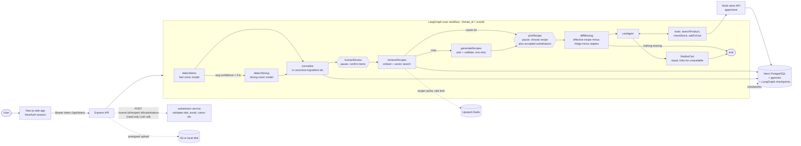

# FridgeToCart

> Snap your fridge → get meals you can cook now → one-tap cart for whatever's missing.

People often have food at home but can't decide what to cook, so they order out or let ingredients
go to waste. FridgeToCart reads a photo of your fridge, suggests recipes you can mostly cook with
what's there, lets you swap missing ingredients for things you already have, and builds a grocery
cart (with Blinkit and Zepto links) for whatever is still missing.

See [PRD.md](PRD.md) for the original spec, [eval/REPORT.md](eval/REPORT.md) for measured results and
[DEPLOYMENT.md](DEPLOYMENT.md) for hosting notes.

**Status:** M1–M4 plus Smart Ingredient Substitution are implemented. M5 (evaluation, docs, CI) is in
place; the app has **not** been deployed anywhere yet (see [Known limitations](#known-limitations)).

## Features

- **Photo → ingredients**: a Gemini vision model lists what it sees; a stronger model re-checks low-confidence photos.
- **Review and edit**: fix, rename or add items before anything is cooked up (a human-in-the-loop pause).
- **Grounded recipes**: retrieval over ~500 real Indian recipes (pgvector), then the LLM picks 3–5 and adapts them; every pick is validated in code.
- **Diet-aware**: vegetarian, non-vegetarian, Jain, egg, plus an avoid list and a time limit.
- **Smart Ingredient Substitution**: AI-suggested swaps for missing ingredients, preferring what you already have, with accept / reject / other options / undo. The original recipe is never changed.
- **Shopping agent**: a tool-using LangGraph agent fills a cart from a mock grocery store; anything it can't find gets Blinkit and Zepto search links.
- **History and preferences**, email + password sign-in (two configured accounts), per-user isolation, rate limiting, Redis recipe cache and built-in per-scan tracing (tokens, ₹ cost, latency).

## Screenshots

<!-- Add real captures here; none are committed yet. -->
| Upload | Review | Recipes + substitutions | Cart |
|---|---|---|---|
| _screenshot placeholder_ | _screenshot placeholder_ | _screenshot placeholder_ | _screenshot placeholder_ |

_Demo GIF placeholder: `docs/demo.gif`._

## Architecture



The substitution endpoint is not a graph node: it only reads the paused scan and returns
suggestions. Accepted substitutions travel with the pick request and are stored in graph state.

## Tech stack

| Layer | Tech |
|---|---|
| Web | Next.js 16 (App Router), React, TypeScript, Tailwind CSS v4, Lucide icons |
| API | Node.js, Express, TypeScript, Zod |
| AI | Gemini (vision, text, embeddings) through LangChain.js; OpenAI/Anthropic specs also supported |
| Orchestration | LangGraph.js with a Postgres checkpointer and `interrupt()` pauses |
| Data | Neon PostgreSQL, pgvector, Prisma |
| Cache / limits | Upstash Redis |
| Auth | NextAuth v5 (Credentials: email + password), short-lived HS256 API tokens |
| Monorepo | pnpm workspaces |

## Layout

| Path | What |
|---|---|
| `apps/web` | Next.js UI (sign-in, upload, review, recipes, cart, history, prefs) on :3000 |
| `apps/api` | Express + LangGraph on :4000 |
| `apps/store` | Mock grocery store on :4100: product search, stock, idempotent carts |
| `packages/shared` | Zod schemas + types shared by every app |
| `prisma/` | Schema and seed data (241 ingredients, 500 recipes, 237 products) |
| `eval/` | Evaluation pipeline and `REPORT.md` |
| `scripts/` | `prepare-recipes` (dataset → `recipes.csv`), `compare-vision`, `dev-token` |

## How a scan flows

```
detectItems → (avg confidence < 0.6 → detectStrong) → normalize → humanReview ⏸
  → retrieveRecipes → (cache hit → pickRecipe) → generateRecipes (↺ once) → pickRecipe ⏸
  → diffMissing → (nothing missing → END)
                → cartAgent ⇄ tools (searchProduct, checkStock, addToCart; ≤ 10 turns) → finalizeCart → END
```

1. The user uploads a photo (resized to ≤ 1280px in the browser, uploaded through a presigned URL).
2. `POST /scans` runs the graph to the first pause and returns detected items.
3. `POST /scans/:id/review` resumes with the edited list, retrieves and generates recipes, and pauses again.
4. Optionally the user asks for substitutions per recipe and accepts or rejects them in the UI.
5. `POST /scans/:id/pick` resumes with the recipe id and accepted substitutions and builds the cart.

### LangGraph workflow

- **Pauses** are LangGraph `interrupt()`s saved by the Postgres checkpointer (`thread_id = scanId`),
  so a scan resumes at the same step after an API restart. `GET /scans/:id` derives the status from
  the pending pause.
- **Confidence routing**: if the fast vision model's average confidence is below 0.6 (or it finds
  nothing, as with a blurry photo), `detectStrong` re-runs detection with `VISION_MODEL_STRONG`. If the
  strong model fails, the scan continues with the fast result.
- **Checkpoints** are written once per request, when the run pauses or ends (`durability: "exit"`),
  because each costs several Neon round trips. A crash mid-run leaves the scan at its last pause;
  repeating the request is safe. A custom `FastPostgresSaver` writes a checkpoint's channels in one statement.
- **Cart**: `diffMissing` takes the chosen (effective) recipe's ingredients minus what the user has,
  minus staples, with no LLM. `cartAgent` is the LLM bound to three store tools and works in parallel
  (all searches, then all stock checks, then all adds), so a cart usually takes 3–4 turns.
  `finalizeCart` then checks the store's cart against the missing list: it removes off-list
  products, adds anything the agent skipped that is in stock, and puts out-of-stock or unknown items
  in `cart.unavailable` with Blinkit/Zepto search links. So every missing item is either in the cart
  or has a link, even if the model is down.
- **No duplicates**: the store *sets* a line's quantity (upsert on `(cartId, productId)`) and replays
  the stored response for a repeated `Idempotency-Key`. The agent's key is deterministic
  (`agent:<productId>:<qty>`), so a retried tool call or a resumed run never adds twice.
- **Staples** (`tags` contains `staple`: salt, water, oil, sugar, haldi and dry spices) are assumed to
  be in the kitchen: never shown as missing, never added to the cart.

### RAG pipeline

- **Data**: `prisma/seed/recipes.csv` (500 recipes), each ingredient mapped to a canonical ingredient id; embedded once into `RecipeDoc.embedding` (pgvector).
- **Retrieval**: embeds the confirmed non-staple ingredients, takes the 30 nearest recipe docs that
  fit the user's diet, max time and avoid list (hard filters in SQL), then re-ranks by how many of
  each recipe's ingredients the user already has (60%) and similarity (40%) and keeps 10.
- **Generation**: the LLM only picks 3–5 of those docs and says which ingredients its version uses
  (it may swap in something the user has). Every pick is checked: it must use a provided doc and only
  that doc's or the user's ingredients, respect diet and avoid, and keep at least two thirds of the
  doc's main ingredients. `have`/`missing` are computed in code, never taken from the model. Invalid
  picks get one retry with the reasons; after that, or if the model is down, the top retrieved docs
  are returned unadapted.
- **Cache**: `hash(sorted canonicalIds + prefs)` → recipes in Redis for 24h, with an in-process layer
  in front. A hit skips embedding, vector search and the LLM. Only validated output is cached.

### Ingredient detection

The fast vision model returns `{rawName, qty, confidence}` items (Zod-validated, one retry on bad
output). `normalize` maps names to canonical ids: exact synonym match first (English and Hindi
names), then one pgvector nearest-neighbour query for the rest; anything still unmatched stays as
`unknown:<name>` and is resolved again after the user's edits. Compare models on your own photos with
`pnpm compare:vision`.

### Smart Ingredient Substitution

- `POST /scans/:id/recipes/:recipeId/substitutions` asks the text model for up to 3 options per
  missing ingredient. The prompt only offers canonical ids that already pass the user's diet and
  avoid list and are not already in the recipe, with fridge items marked.
- The server re-validates every returned option (known id, not in the recipe, diet, avoid), derives
  `in_fridge` vs `must_buy` itself, and puts pantry items first. Unusable options are dropped; with
  none left the UI says no substitutes were found.
- Accepted substitutions are sent with `/pick`, re-validated server-side (names come from the canon,
  never the client) and stored in graph state. `applySubstitutions` (in `packages/shared`) builds the
  effective recipe for display and for `diffMissing`; the stored original recipe is never modified.
  An in-fridge substitute leaves the cart; one that must be bought is added to it.
- Suggestions are fetched only when the user clicks, so no model calls happen otherwise.

## API

| Method | Path | Notes |
|---|---|---|
| POST | `/uploads/presign` | `{contentType}` → `{uploadUrl, imageUrl}` |
| POST | `/scans` | `{imageUrl}` → `{scanId, status, items}`; runs to the review pause |
| POST | `/scans/:id/review` | `{items: Ingredient[]}` → `{status, recipes}`; runs to the pick pause |
| POST | `/scans/:id/recipes/:recipeId/substitutions` | → `{suggestions}`; read-only, needs the scan to be at the pick pause |
| POST | `/scans/:id/pick` | `{recipeId, substitutions?}` → `{status, cart}`; builds the cart (`cart` is null if nothing is missing) |
| PUT | `/scans/:id/cart/items/:productId` | `{qty}` (0–20, 0 removes) → cart; the qty stepper |
| GET | `/scans/:id` | items, confirmed items, recipes, substitutions, status (from the checkpoint) and the live cart |
| GET | `/scans/:id/trace` | path, models, calls, cost |
| GET | `/scans` | the user's past scans |
| GET/PUT | `/prefs` | `{diet, avoid, maxTimeMins}` |
| GET | `/health` | liveness, no auth |

All routes except `/health` and the local upload PUT/GET need `Authorization: Bearer <token>`.
Errors are `{error: {code, message}}`.

### Store API (apps/store)

| Method | Path | Notes |
|---|---|---|
| GET | `/products?q=` | fuzzy search over product names and ingredient names/synonyms (Hindi too) |
| GET | `/products/:id/stock` | `{productId, stock, inStock}` |
| POST | `/carts` | `{scanId}` → cart; one cart per scan |
| POST | `/carts/:id/items` | `{productId, qty}` + `Idempotency-Key` header; sets qty (0 removes), 409 if out of stock |
| GET | `/carts/:id` | items with deep links, total |
| GET | `/health` | liveness |

Products are a demo catalogue (`prisma/seed/products.csv`); five niche items start out of stock to
exercise the fallback links. There is no checkout.

## Database

Prisma models (`prisma/schema.prisma`): `User` (diet, avoid list, max time), `Scan` (status,
selected recipe), `IngredientCanon` (canonical ids, synonyms, tags, embedding), `RecipeDoc`
(ingredients, steps, diet tags, embedding), `Product`, `Cart` / `CartItem` (store side) and
`LlmCall` (per-call tokens, cost, latency). LangGraph checkpoints live in their own Postgres schema,
`langgraph`, so `prisma db push` (which manages `public`) never touches them. Never run
`db push --accept-data-loss` to "fix" a warning about them.

## Local setup

Prereqs: Node 20+, pnpm 9, and Docker (or a Neon Postgres with pgvector + any Redis).

```bash
pnpm install
cp .env.example .env          # set GOOGLE_API_KEY (all default models are Gemini)
pnpm db:up                    # postgres+pgvector, redis via docker compose
pnpm db:generate && pnpm db:push && pnpm db:seed
pnpm dev                      # web + api + store
```

Open http://localhost:3000, sign in, take or pick a photo, and press **Scan**. Seeding embeds
the recipes and ingredients with the embedding model, which calls the Gemini API.

### Sign-in

The web app signs users in with NextAuth (v5), then trades the session for a 15-minute HS256 token
(`/api/token`) that the API verifies with the shared `API_JWT_SECRET`. User ids are stable:
`demo:tester`, `demo:admin` or (local dev login) `dev:<email>`.

- **Email + password**: exactly two accounts, with the emails fixed in `apps/web/lib/demoAuth.ts` and
  the passwords taken from the environment (never committed):

  | Account | Email | Password variable | Role |
  |---|---|---|---|
  | Tester | `tester@fridgetocart.demo` | `DEMO_USER_PASSWORD` | `user` |
  | Admin | `aditi@fridgetocart.demo` | `ADMIN_PASSWORD` | `admin` |

  Email is compared case-insensitively; passwords must be at least 8 characters, otherwise that
  account is disabled. Passwords are verified on the server with scrypt and a constant-time
  comparison, and a wrong password and an unknown email give the same error. The role is stored in the
  session and token and is **not used by any feature yet**; it is reserved for future admin functionality.
  The sign-in page deliberately **displays the tester email and password** so portfolio visitors can try
  the app, so choose a throwaway value. The admin credentials are never displayed. There is no
  lockout or login rate limiting; the only cost control is the per-user scan limit (10 per hour, needs Redis).
- **Dev login**: with `AUTH_DEV_LOGIN=true`, `/signin` also offers email-only sign-in (no password).
  It is always off when `NODE_ENV=production`.
- **curl**: `curl -H "Authorization: Bearer $(pnpm -s dev:token you@example.com)" localhost:4000/scans`

## Environment variables

All apps read one `.env` at the repo root (see `.env.example`); on a host, set them per service.
`apps/web` additionally reads `NEXT_PUBLIC_API_URL` (see `apps/web/.env.example`).

| Variable | Used by | Notes |
|---|---|---|
| `DATABASE_URL` | api, store, prisma | Required. Pooled URL on Neon. |
| `DATABASE_URL_UNPOOLED` | prisma | Direct URL for `db push` / migrations. |
| `UPSTASH_REDIS_REST_URL` / `_TOKEN` | api | Optional. Without them the cache and rate limit are skipped. |
| `GOOGLE_API_KEY` | api | Needed for any Gemini model. |
| `OPENAI_API_KEY`, `ANTHROPIC_API_KEY` | api | Only if you route a role to those providers. |
| `VISION_MODEL_FAST`, `VISION_MODEL_STRONG`, `TEXT_MODEL`, `EMBED_MODEL` | api | `"<provider>:<model>"` specs. |
| `EMBED_DIM` | api, prisma | Default 1536, max 2000. Must match the `vector(N)` columns; the API refuses to start otherwise. |
| `USD_INR` | api | Converts per-call USD cost to ₹ in logs. |
| `S3_BUCKET`, `S3_REGION`, `AWS_ACCESS_KEY_ID`, `AWS_SECRET_ACCESS_KEY` | api | Empty `S3_BUCKET` stores uploads on local disk (dev only). |
| `API_PORT`, `API_BASE_URL`, `WEB_ORIGIN` | api | `WEB_ORIGIN` is the single origin CORS allows. |
| `STORE_PORT`, `STORE_BASE_URL` | store, api | Where the api finds the store. |
| `NEXTAUTH_SECRET` | web | Session secret. |
| `API_JWT_SECRET` | web, api | ≥ 32 chars; signs and verifies API tokens. |
| `DEMO_USER_PASSWORD` | web | Password of `tester@fridgetocart.demo` (role `user`). **Shown on the sign-in page.** Min 8 chars. |
| `ADMIN_PASSWORD` | web | Password of `aditi@fridgetocart.demo` (role `admin`). Private. Min 8 chars. |
| `AUTH_TRUST_HOST` | web | `true` if sign-in complains about the host. |
| `AUTH_DEV_LOGIN` | web | Local only; ignored in production. |
| `NEXT_PUBLIC_API_URL` | web | Browser-visible API base URL. |
| `LANGSMITH_API_KEY`, `LANGSMITH_TRACING`, `LANGSMITH_PROJECT` | api | Optional LangSmith tracing. |

Models are routed with `"<provider>:<model>"` specs. Defaults:

| Role | Model |
|---|---|
| `VISION_MODEL_FAST` | `google:gemini-3.5-flash-lite` |
| `VISION_MODEL_STRONG` | `google:gemini-3.5-flash` |
| `TEXT_MODEL` | `google:gemini-3.5-flash-lite` (flash took ~40s for recipes; lite ~3s) |
| `EMBED_MODEL` | `google:gemini-embedding-2` |

## Testing

```bash
pnpm typecheck   # shared, api, store, web, and the root scripts/eval
pnpm test        # Vitest (api + store); LLM, store and database are mocked, no keys needed
pnpm --filter ./apps/web build
```

GitHub Actions runs these on every push and pull request (`.github/workflows/ci.yml`) with
placeholder environment variables and no secrets.

`pnpm compare:vision` runs the fast and strong vision models on the photos in `eval/images/`; it
**calls the paid API**.

## Evaluation

`pnpm eval` regenerates [eval/REPORT.md](eval/REPORT.md) from data already in the database, with no
new model calls. Latest run (full detail, methods and caveats in the report):

| Goal | Result |
|---|---|
| G1 detection P ≥ 0.80, R ≥ 0.70 | **Not yet measured.** There are no ground-truth labels. A *user-confirmation agreement proxy* over 22 development scans is reported separately (micro P 0.43 / R 0.51) and is **not** a substitute: it is bimodal and may reflect test runs. |
| G2 grounding ≥ 90% | 102/102 recipes grounded; not an independent test, because the app already rejects ungrounded picks. |
| G3 every missing item has a product or link | True by construction; 131 of 134 distinct recipe ingredients (97.8%) have an in-stock store product, the other 3 get deep links. |
| G4 p95 photo → recipes < 12 s | **Not yet measured** end to end. Model time alone: p50 7.3 s, p95 10.7 s over 6 scans (a lower bound). |
| G5 avg LLM cost < ₹2 per scan | About ₹0.159 per scan over 19 dev scans; the price table was not re-verified and embeddings are logged as ₹0. |

To measure G1 properly, add photos to `eval/images/` and checked labels to `eval/labels.json`, then
run `pnpm eval --allow-llm` (this calls the paid API).

## Deployment

See [DEPLOYMENT.md](DEPLOYMENT.md). Planned layout: web on Vercel; API and store on Render or
Railway; existing Neon and Upstash. Nothing is deployed yet.

## Known limitations

- Not deployed; hosting and upload storage are documented but untested in production.
- No ground-truth detection benchmark (G1) and no end-to-end latency measurement (G4).
- Substitution quality (is the swap sensible?) is only validated for diet, avoid list and ids, not culinary quality.
- Unconfirmed substitution choices live in the browser until a recipe is picked, so a refresh loses them.
- Image storage supports S3 or local disk only (no Cloudinary), and local disk is not suitable for hosts with ephemeral storage.
- The store is a demo catalogue with no checkout; Blinkit/Zepto links are search URLs, not product deep links.
- Recipes are limited to 500 quick Indian dishes (some non-vegetarian, e.g. fish curries); diet tags come from ingredient tags.
- Cost figures rely on a hand-maintained price table.

## Recipe data and attribution

`prisma/seed/recipes.csv` holds 500 recipes adapted from the
[6000+ Indian Food Recipes Dataset](https://data.mendeley.com/datasets/xsphgmmh7b/1) by Kanishka Jain
(Mendeley Data, doi:10.17632/xsphgmmh7b.1), licensed
[CC BY 4.0](https://creativecommons.org/licenses/by/4.0/). The recipes originally come from
Archana's Kitchen; each row keeps its source URL, and the app links to it.

Changes made: kept quick (≤ 60 min) Indian mains, sides, breakfasts and snacks in English; mapped
every ingredient to a canonical ingredient (recipes with any unmapped ingredient were dropped);
split instructions into steps; fixed machine-translated titles; derived diet tags from ingredients.
To rebuild it (the 24 MB source CSV is not committed):

```bash
pnpm prepare:recipes path/to/IndianFoodDatasetCSV.csv
pnpm db:seed     # upserts and embeds only new or changed rows
```

## Tracing and performance notes

- `GET /scans/:id/trace` is the built-in trace: the path the graph took, which model's detections
  were used, whether recipes came from cache, and every LLM/embedding call with tokens, ₹ cost and latency (stored in `LlmCall`).
- Every node logs `{evt:"node", node, ms}`; `POST /review` logs a per-phase `spans` breakdown.
- With `LANGSMITH_TRACING=true` and `LANGSMITH_API_KEY`, full runs show up in LangSmith.
- Neon (Singapore) costs ~100 ms per round trip and Upstash ~130–300 ms from India, so round trips,
  not models, dominated latency. Measured informally on a cache hit, `POST /review` took 0.77–0.85 s
  (was 3.4 s); photo → recipes on a miss was roughly 9–12 s, mostly the two model calls. These are
  development observations, not a controlled benchmark.
